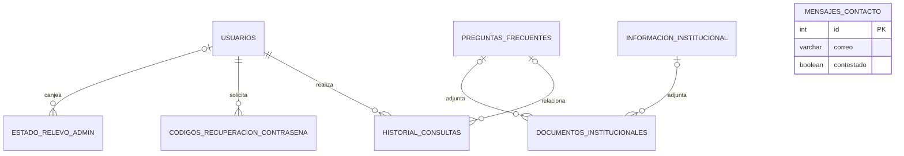

# Diccionario de datos — Lobo UPVT

**Base de datos:** `lobo_upvt_db`  
**Motor:** MySQL / InnoDB  
**Codificación:** `utf8mb4`  
**Fecha de elaboración:** 30 de octubre de 2026  
**Última actualización:** 25 de noviembre de 2026 (migraciones hasta la `019`)

## 1. Propósito

Este documento describe las tablas utilizadas por el sistema Lobo UPVT para administrar cuentas, preguntas y respuestas, información institucional, archivos, consultas del kiosko, mensajes de contacto, recuperación de contraseña y relevo del administrador principal.

El diccionario se elaboró con los modelos SQLAlchemy del backend, el archivo `lobo_upvt_db.sql` y las migraciones numeradas hasta `019_papelera_mensajes_contacto.sql`. Las migraciones son evolutivas: cada cambio nuevo debe agregarse como una migración numerada posterior.

## 2. Convenciones

- **PK:** clave primaria.
- **FK:** clave foránea.
- **UQ:** valor único.
- **NULL:** el campo puede quedar vacío.
- **NOT NULL:** el campo es obligatorio.
- En MySQL, `BOOLEAN` se almacena como `TINYINT(1)`.
- Las respuestas y contenidos extensos usan `MEDIUMTEXT`.
- Los archivos adjuntos se conservan en el directorio de archivos del backend; MySQL guarda sus metadatos y su clave de almacenamiento, no los bytes del archivo.
- Las columnas `papelera_en` permiten archivar registros (usuarios, preguntas, información, documentos y mensajes de contacto). El proceso de la aplicación elimina los elementos de la papelera después de 30 días.

## 3. Diagrama de relaciones

`documentos_institucionales` puede asociarse con información institucional o con una pregunta frecuente. La aplicación procura asignar cada archivo a uno de esos registros; la base define ambas relaciones como opcionales y no impone una regla XOR entre ellas. `mensajes_contacto` no tiene relaciones con otras tablas.

## 4. Tabla `usuarios`

**Finalidad:** cuentas registradas en el sistema, roles, autorización y estado de acceso.

| Campo | Tipo | Nulo | Clave / valor | Descripción |
|---|---|---:|---|---|
| `id` | `INT` | No | PK, autoincremental | Identificador interno de la cuenta. |
| `nombre` | `VARCHAR(100)` | No |  | Nombre de la persona. |
| `email` | `VARCHAR(100)` | No | UQ | Correo utilizado para iniciar sesión; en Python se expone como `correo`. |
| `password_hash` | `VARCHAR(255)` | No |  | Hash de contraseña. Nunca debe guardar la contraseña en texto plano. |
| `rol` | `ENUM` | No | `admin`, `admin_contenido`, `directivo`, `profesor`, `alumno`; default `alumno` | Perfil de permisos de la cuenta. |
| `matricula_empleado` | `VARCHAR(20)` | Sí | UQ | Matrícula o identificador de empleado, si corresponde. |
| `carrera` | `VARCHAR(150)` | Sí |  | Carrera asociada a la cuenta, cuando aplica. |
| `activo` | `BOOLEAN` | No | Default `TRUE` | Indica si la cuenta puede acceder al sistema. |
| `estado_solicitud` | `ENUM` | No | `pendiente`, `aprobada`, `rechazada`; default `aprobada` | Estado de autorización de la cuenta. |
| `creado_en` | `TIMESTAMP` | No | Default fecha/hora actual | Fecha de creación. |
| `papelera_en` | `TIMESTAMP` | Sí |  | Fecha de envío a la papelera; `NULL` significa que la cuenta no está en ella (migración 012). |

**Índices:** `ix_usuarios_estado_rol` sobre (`estado_solicitud`, `rol`) e `ix_usuarios_papelera_en`.  
**Relaciones:** una cuenta puede asociarse a muchos registros de `historial_consultas` y de `codigos_recuperacion_contrasena`, y puede figurar como quien canjeó la clave de relevo en `estado_relevo_admin`. Al eliminar una cuenta, `historial_consultas.usuario_id` y `estado_relevo_admin.usada_por_id` quedan en `NULL`; sus códigos de recuperación se eliminan.

## 5. Tabla `preguntas_frecuentes`

**Finalidad:** respuestas institucionales predefinidas que el kiosko busca y presenta a visitantes.

| Campo | Tipo | Nulo | Clave / valor | Descripción |
|---|---|---:|---|---|
| `id` | `INT` | No | PK, autoincremental | Identificador de la pregunta frecuente. |
| `categoria` | `VARCHAR(50)` | No | Default `General` | Área temática de la pregunta. |
| `pregunta` | `VARCHAR(255)` | No | Índice | Pregunta o frase de referencia que se busca. |
| `respuesta` | `MEDIUMTEXT` | No |  | Respuesta visible para el usuario. |
| `palabras_clave` | `VARCHAR(255)` | Sí | Índice FULLTEXT | Términos alternativos que ayudan a recuperar la respuesta. |
| `dirigido_a` | `ENUM` | No | `todos`, `alumnos`, `profesores`, `directivos`; default `todos` | Público al que se dirige la respuesta. |
| `animacion` | `VARCHAR(80)` | No | Default `idle` | Identificador de animación que puede consumir el avatar. |
| `emocion` | `VARCHAR(80)` | No | Default `neutral` | Identificador de emoción para el avatar. |
| `accion_avatar` | `VARCHAR(500)` | No | Default vacío | Instrucción descriptiva del gesto que debe realizar el avatar al responder (migración 015). |
| `activo` | `BOOLEAN` | No | Default `TRUE` | Indica si la pregunta puede utilizarse en el kiosko. |
| `creado_en` | `TIMESTAMP` | No | Default fecha/hora actual | Fecha de creación. |
| `papelera_en` | `TIMESTAMP` | Sí |  | Fecha de envío a la papelera; `NULL` significa que no está en ella. |

**Índices:** `ix_preguntas_frecuentes_pregunta`, `ix_preguntas_activo_categoria` sobre (`activo`, `categoria`), `ix_preguntas_papelera_en` y FULLTEXT `ft_preguntas_busqueda` sobre (`pregunta`, `palabras_clave`).  
**Relaciones:** puede aparecer en muchos registros de historial y tener varios documentos adjuntos. Al eliminar físicamente una pregunta, el vínculo desde el historial se establece en `NULL`; los adjuntos tienen restricción `RESTRICT`.

## 6. Tabla `informacion_institucional`

**Finalidad:** información institucional editable que puede consultar el kiosko, independiente del módulo de preguntas frecuentes.

| Campo | Tipo | Nulo | Clave / valor | Descripción |
|---|---|---:|---|---|
| `id` | `INT` | No | PK, autoincremental | Identificador del contenido. |
| `clave` | `VARCHAR(100)` | No | UQ | Identificador estable del registro, por ejemplo `ubicacion-upvt`. |
| `titulo` | `VARCHAR(180)` | No | FULLTEXT | Título descriptivo. |
| `contenido` | `MEDIUMTEXT` | No | FULLTEXT | Texto institucional consultable por el kiosko. |
| `categoria` | `VARCHAR(80)` | No | Default `General`, FULLTEXT | Clasificación temática del contenido. |
| `activo` | `BOOLEAN` | No | Default `TRUE` | Indica si el contenido está publicado para consulta. |
| `creado_en` | `TIMESTAMP` | No | Default fecha/hora actual | Fecha de creación. |
| `actualizado_en` | `TIMESTAMP` | No | Actualización automática | Fecha de la última modificación. |
| `papelera_en` | `TIMESTAMP` | Sí |  | Fecha de envío a la papelera; `NULL` significa que no está en ella. |
| `accion_avatar` | `VARCHAR(500)` | No | Default vacío | Instrucción descriptiva del gesto del avatar al presentar esta información (migración 015). |
| `animacion` | `VARCHAR(80)` | No | Default `Hablar` | Animación del avatar que acompaña esta información (migración 018). |
| `emocion` | `VARCHAR(20)` | No | Default `neutral` | Emoción del avatar que acompaña esta información (migración 018). |

**Índices:** `ix_informacion_activa_categoria` sobre (`activo`, `categoria`), `ix_informacion_papelera_en` y FULLTEXT `ft_informacion_busqueda` sobre (`clave`, `titulo`, `contenido`, `categoria`).  
**Relaciones:** una ficha puede tener varios registros en `documentos_institucionales`. La relación impide eliminar físicamente la ficha mientras existan adjuntos relacionados.

## 7. Tabla `documentos_institucionales`

**Finalidad:** metadatos y texto extraído de PDFs e imágenes adjuntos a información institucional o a preguntas frecuentes.

| Campo | Tipo | Nulo | Clave / valor | Descripción |
|---|---|---:|---|---|
| `id` | `INT` | No | PK, autoincremental | Identificador del documento. |
| `informacion_id` | `INT` | Sí | FK → `informacion_institucional.id` | Ficha institucional a la que se adjunta, si corresponde. Borrado restringido (`RESTRICT`). |
| `pregunta_frecuente_id` | `INT` | Sí | FK → `preguntas_frecuentes.id` | Pregunta frecuente a la que se adjunta, si corresponde. Borrado restringido (`RESTRICT`). |
| `nombre_archivo` | `VARCHAR(255)` | No | FULLTEXT | Nombre original del archivo. |
| `archivo_key` | `CHAR(36)` | No | UQ | Clave UUID usada para localizar el archivo guardado fuera de MySQL. |
| `mime_type` | `VARCHAR(100)` | No | Default `application/pdf` | Tipo MIME, por ejemplo `application/pdf` o `image/jpeg`. |
| `tamano_bytes` | `INT UNSIGNED` | No |  | Tamaño original del archivo en bytes. |
| `contenido_extraido` | `MEDIUMTEXT` | Sí | FULLTEXT | Texto extraído del PDF e índice útil para las búsquedas. Las imágenes pueden no tener texto extraído. |
| `estado_indice` | `ENUM` | No | `pendiente`, `listo`, `error`; default `listo` | Estado del análisis/indexación del documento. |
| `activo` | `BOOLEAN` | No | Default `TRUE` | Indica si el documento está disponible públicamente. |
| `creado_en` | `TIMESTAMP` | No | Default fecha/hora actual | Fecha de carga. |
| `papelera_en` | `TIMESTAMP` | Sí |  | Fecha de envío a la papelera; `NULL` significa que no está en ella. |

**Índices:** `ix_documentos_info_activo` sobre (`informacion_id`, `activo`), `ix_documentos_pregunta_activo` sobre (`pregunta_frecuente_id`, `activo`), `ix_documentos_papelera_en` y FULLTEXT `ft_documentos_busqueda` sobre (`nombre_archivo`, `contenido_extraido`). `archivo_key` es único.

## 8. Tabla `historial_consultas`

**Finalidad:** registro de consultas y respuestas para métricas y seguimiento de la atención del kiosko.

| Campo | Tipo | Nulo | Clave / valor | Descripción |
|---|---|---:|---|---|
| `id` | `INT` | No | PK, autoincremental | Identificador de la interacción. |
| `usuario_id` | `INT` | Sí | FK → `usuarios.id` | Cuenta asociada, si la consulta se atribuye a una persona. En el kiosko público normalmente es `NULL`; al borrar la cuenta se establece `NULL`. |
| `pregunta_usuario` | `TEXT` | No |  | Texto escrito o transcrito de la consulta. En Python se expone como `mensaje`. |
| `respuesta_bot` | `TEXT` | No |  | Respuesta generada o seleccionada por el sistema. En Python se expone como `respuesta`. |
| `origen` | `ENUM` | No | `kiosko_kinect`, `panel_web`; default `kiosko_kinect` | Interfaz que originó la consulta. |
| `pregunta_frecuente_id` | `INT` | Sí | FK → `preguntas_frecuentes.id` | FAQ asociada, si se encontró; al borrar la FAQ se establece `NULL`. |
| `categoria` | `VARCHAR(80)` | No | Default `Sin clasificar` | Categoría del contenido que respondió o clasificación del saludo, aclaración o consulta sin coincidencia. |
| `modulo` | `VARCHAR(40)` | No | Default en la base `consulta_anterior` | Módulo que respondió (`conversacion`, `preguntas_respuestas`, `informacion_institucional`, entre otros). `consulta_anterior` marca filas previas a la migración 013 que no conservaban ese dato; el backend asigna `consulta_general` cuando no indica un módulo. |
| `clave_solicitud` | `VARCHAR(64)` | Sí | Única cuando no es `NULL` | Identificador de reintento generado por el kiosko para impedir duplicar una consulta al recuperar la conexión. |
| `accion_avatar` | `VARCHAR(500)` | No | Default vacío | Instrucción textual del avatar asociada con la respuesta. |
| `animacion` | `VARCHAR(80)` | No | Default `idle` | Animación que corresponde a la respuesta. |
| `emocion` | `VARCHAR(80)` | No | Default `neutral` | Emoción que corresponde a la respuesta. |
| `fecha_consulta` | `TIMESTAMP` | No | Default fecha/hora actual | Momento de la consulta. |

**Índices:** `ix_historial_fecha` sobre (`fecha_consulta`) y `uq_historial_clave_solicitud` único sobre (`clave_solicitud`). La columna `modulo` requiere la migración 013 y las columnas `clave_solicitud`, `categoria`, `accion_avatar`, `animacion` y `emocion` requieren la 017. Como `clave_solicitud` admite `NULL`, varias filas pueden carecer de clave sin violar la unicidad.

## 9. Tabla `mensajes_contacto`

**Finalidad:** mensajes que visitantes envían desde el formulario “Contáctanos” del kiosko. La bandeja administrativa permite consultarlos y marcarlos como leídos o nuevos.

| Campo | Tipo | Nulo | Clave / valor | Descripción |
|---|---|---:|---|---|
| `id` | `INT` | No | PK, autoincremental | Identificador del mensaje. |
| `nombre` | `VARCHAR(100)` | No |  | Nombre proporcionado por quien contacta. |
| `correo` | `VARCHAR(254)` | No |  | Correo de contacto para responder. |
| `asunto` | `VARCHAR(160)` | No |  | Tema del mensaje. |
| `mensaje` | `TEXT` | No |  | Cuerpo del mensaje. |
| `leido` | `BOOLEAN` | No | Default `FALSE` | Estado de revisión del mensaje. |
| `creado_en` | `TIMESTAMP` | No | Default fecha/hora actual | Fecha de recepción. |
| `contestado` | `BOOLEAN` | No | Default `FALSE` | Indica si el mensaje ya recibió respuesta por correo (migración 016). |
| `contestado_en` | `TIMESTAMP` | Sí |  | Fecha y hora en que se registró la respuesta; `NULL` si aún no se contesta (migración 016). |
| `papelera_en` | `TIMESTAMP` | Sí |  | Fecha de envío a la papelera; `NULL` significa que no está en ella (migración 019). |

**Índices:** `ix_mensajes_contacto_fecha` sobre (`creado_en`), `ix_mensajes_contacto_leido_fecha` sobre (`leido`, `creado_en`), `ix_mensajes_contacto_contestado_fecha` sobre (`contestado`, `contestado_en`) e `ix_mensajes_contacto_papelera_en`. El panel solo registra si se respondió; el sistema no envía esa respuesta automáticamente desde esta tabla.

## 10. Tabla `codigos_recuperacion_contrasena`

**Finalidad:** códigos de un solo uso para recuperar cuentas administrativas (migración 011). Se guarda el hash del código, no el código en claro.

| Campo | Tipo | Nulo | Clave / valor | Descripción |
|---|---|---:|---|---|
| `id` | `INT` | No | PK, autoincremental | Identificador del código. |
| `usuario_id` | `INT` | No | FK → `usuarios.id` | Cuenta para la que se generó el código. Al borrar la cuenta se eliminan sus códigos (`CASCADE`). |
| `codigo_hash` | `CHAR(64)` | No |  | Hash del código de recuperación. |
| `intentos` | `INT` | No | Default `0` | Número de intentos fallidos de verificación. |
| `creado_en` | `TIMESTAMP` | No | Default fecha/hora actual | Fecha de emisión. |
| `expira_en` | `TIMESTAMP` | No |  | Fecha y hora de vencimiento del código. |
| `usado_en` | `TIMESTAMP` | Sí |  | Fecha de uso; `NULL` mientras no se haya canjeado. |

**Índice:** `ix_recuperacion_usuario_fecha` sobre (`usuario_id`, `creado_en`).

## 11. Tabla `estado_relevo_admin`

**Finalidad:** registra si la clave de relevo de emergencia del administrador principal ya fue canjeada, para que solo pueda usarse una vez (migración 014). Contiene una única fila (`id = 1`), sembrada por la migración.

| Campo | Tipo | Nulo | Clave / valor | Descripción |
|---|---|---:|---|---|
| `id` | `TINYINT UNSIGNED` | No | PK | Identificador de la fila de estado; siempre `1`. |
| `usada_en` | `TIMESTAMP` | Sí | Default `NULL` | Momento en que se canjeó la clave; `NULL` si sigue disponible. |
| `usada_por_id` | `INT` | Sí | FK → `usuarios.id` | Cuenta que canjeó la clave. Al borrar la cuenta se establece `NULL` (`SET NULL`). |

## 12. Relaciones y reglas de integridad

| Relación | Cardinalidad | Regla al borrar |
|---|---|---|
| `usuarios.id` → `historial_consultas.usuario_id` | Una cuenta puede tener muchas consultas | `SET NULL`; conserva el historial. |
| `preguntas_frecuentes.id` → `historial_consultas.pregunta_frecuente_id` | Una FAQ puede relacionarse con muchas consultas | `SET NULL`; conserva el historial. |
| `informacion_institucional.id` → `documentos_institucionales.informacion_id` | Una ficha puede tener varios documentos | `RESTRICT`; primero deben retirarse o eliminarse los adjuntos. |
| `preguntas_frecuentes.id` → `documentos_institucionales.pregunta_frecuente_id` | Una FAQ puede tener varios documentos | `RESTRICT`; primero deben retirarse o eliminarse los adjuntos. |
| `usuarios.id` → `codigos_recuperacion_contrasena.usuario_id` | Una cuenta puede tener varios códigos de recuperación | `CASCADE`; los códigos se eliminan con la cuenta. |
| `usuarios.id` → `estado_relevo_admin.usada_por_id` | Una cuenta puede figurar como quien canjeó el relevo | `SET NULL`; conserva el registro de canje. |

## 13. Historial de migraciones

| N.º | Archivo | Cambio |
|---:|---|---|
| 001 | `001_fastapi_alignment.sql` | Alinea la base con FastAPI: `estado_solicitud`, `animacion`, `emocion`, `pregunta_frecuente_id`, índices y la tabla `informacion_institucional`. |
| 002 | `002_documentos_institucionales.sql` | Crea `documentos_institucionales`. |
| 003 | `003_documentos_texto_busqueda.sql` | Agrega `contenido_extraido` a los documentos. |
| 004 | `004_papelera_retencion_30_dias.sql` | `papelera_en` en información institucional y documentos. |
| 005 | `005_document_index_status.sql` | Agrega `estado_indice` a los documentos. |
| 006 | `006_adjuntos_preguntas_y_papelera.sql` | Permite adjuntar documentos a preguntas frecuentes y agrega `papelera_en` a las preguntas. |
| 007 | `007_administrador_contenido.sql` | Agrega el rol `admin_contenido`. |
| 008 | `008_contenido_extenso.sql` | Pasa respuestas y contenidos a `MEDIUMTEXT`. |
| 009 | `009_busqueda_fulltext.sql` | Índices FULLTEXT para preguntas, información y documentos. |
| 010 | `010_mensajes_contacto.sql` | Crea `mensajes_contacto`. |
| 011 | `011_recuperacion_contrasena.sql` | Crea `codigos_recuperacion_contrasena`. |
| 012 | `012_papelera_usuarios.sql` | `papelera_en` en `usuarios`. |
| 013 | `013_modulo_historial.sql` | Agrega `modulo` a `historial_consultas`. |
| 014 | `014_relevo_emergencia_admin.sql` | Crea `estado_relevo_admin` y siembra su fila única. |
| 015 | `015_accion_avatar.sql` | Agrega `accion_avatar` a preguntas e información institucional. |
| 016 | `016_historial_respuestas_contacto.sql` | Agrega `contestado` y `contestado_en` a `mensajes_contacto`. |
| 017 | `017_chat_idempotency_avatar_metadata.sql` | Agrega `clave_solicitud`, `categoria`, `accion_avatar`, `animacion` y `emocion` al historial. |
| 018 | `018_animacion_info_institucional.sql` | Agrega `animacion` y `emocion` a la información institucional. |
| 019 | `019_papelera_mensajes_contacto.sql` | `papelera_en` en `mensajes_contacto`. |

## 14. Notas de seguridad y mantenimiento

1. `password_hash` y `codigo_hash` contienen únicamente hashes; nunca se documentan ni almacenan contraseñas ni códigos reales aquí.
2. `mensajes_contacto` contiene datos de contacto. Su lectura está restringida al administrador general.
3. Solo se deben publicar datos institucionales y adjuntos autorizados para el público.
4. La papelera conserva los registros temporalmente; el proceso de limpieza elimina los vencidos después de 30 días.
5. Para cambiar el esquema, crear una migración siguiente (actualmente `020_...sql`) y conservar las migraciones anteriores.
6. Revisar y sincronizar este documento cuando cambien `backend/models.py` o las migraciones.

## 15. Fuentes del diccionario

- `backend/models.py`
- `backend/migrations/001_fastapi_alignment.sql` a `backend/migrations/019_papelera_mensajes_contacto.sql`
- `lobo_upvt_db.sql`
